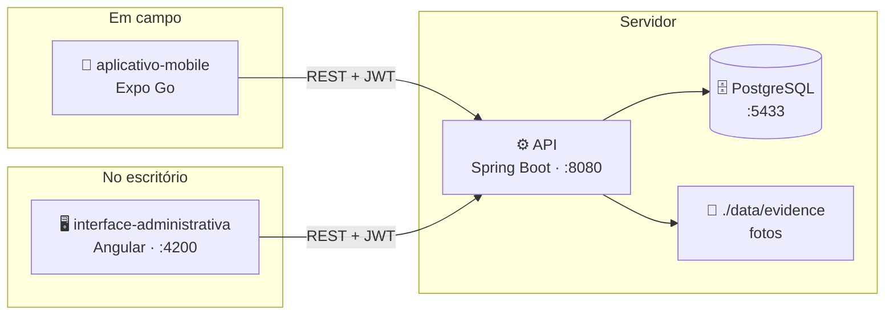
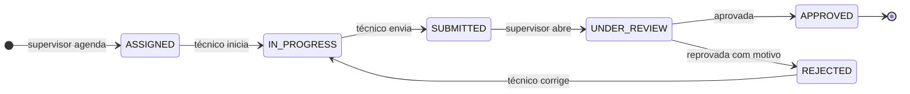

# FieldOps API

API REST do FieldOps — plataforma de planejamento, execução e revisão de inspeções técnicas em campo.
Implementa as regras de negócio, autenticação, persistência e auditoria descritas na especificação do
projeto (`../docs/fieldops-spec.md`, seções 09 a 12).

Stack: Java 21, Spring Boot 3.3, Spring Security (JWT), Spring Data JPA, PostgreSQL 16, Flyway,
springdoc-openapi (Swagger UI), Testcontainers para os testes de integração.

## O projeto FieldOps

Plataforma de **planejamento, execução e revisão de inspeções técnicas em campo**. Um supervisor
planeja a inspeção e monta o checklist na web; o técnico executa no celular, diante do ativo, com ou
sem sinal; o supervisor revisa, aprova ou reprova. Tudo fica auditado.

São três repositórios independentes:

| Repositório | O que é | Stack |
|---|---|---|
| [`API`](https://github.com/Project-FielOps/API) **← você está aqui** | Regras de negócio, autenticação, persistência e auditoria | Java 21 · Spring Boot 3.3 · PostgreSQL 16 |
| [`interface-administrativa`](https://github.com/Project-FielOps/interface-administrativa) | Web do supervisor: cadastros, modelos, planejamento e revisão | Angular 22 · Angular Material |
| [`aplicativo-mobile`](https://github.com/Project-FielOps/aplicativo-mobile) | App do técnico em campo | Expo SDK 57 · React Native |

### Arquitetura



Não há comunicação direta entre o app e a web: **a API é o ponto de encontro**. O técnico responde o
checklist no celular e aquilo aparece na revisão do supervisor porque os dois falam com o mesmo
backend.

### Ciclo de vida de uma inspeção



| Etapa | Onde | Perfil |
|---|---|---|
| Cadastros, modelos de checklist, agendamento | Web | `ADMIN` · `SUPERVISOR` |
| Verificação do ativo, execução, evidências, não conformidades | Mobile | `TECHNICIAN` |
| Revisão, aprovação e reprovação | Web | `SUPERVISOR` |

### Subindo o ambiente completo

Na ordem — **banco → API → web / mobile**. Cada repositório detalha a sua parte no próprio README.

```bash
# 1. Banco (repositório API)
cd API && docker compose up -d

# 2. API — exige JDK 21; o Spring Boot 3.3.4 não roda bem em JDK mais novo
mvn -DskipTests package && java -jar target/fieldops-api-0.1.0.jar

# 3. Web
cd interface-administrativa && npm install && npm start

# 4. Mobile — celular na mesma Wi-Fi, aberto pelo Expo Go
cd aplicativo-mobile && npm install && npm start
```

| Porta | Serviço |
|---|---|
| `5433` | PostgreSQL (container) |
| `8080` | API · Swagger em `/swagger-ui.html` |
| `4200` | Interface administrativa |
| `8081` | Metro bundler (Expo) |

> No Windows, o firewall costuma bloquear entrada nas portas **8080** e **8081**. Se o celular não
> conectar no Expo Go, libere as duas para a rede privada.

### Usuários de desenvolvimento

O seed da API cria um usuário por papel — **apenas** no perfil `dev` e só com o banco vazio.

**As senhas não estão neste repositório.** Todas vêm de `FIELDOPS_SEED_PASSWORD`, que você define no
`.env` da API (veja `.env.example`). Sem essa variável o seed não roda, e nenhuma conta de
administrador com senha conhecida chega a existir.

| Perfil | E-mail | Usa |
|---|---|---|
| `ADMIN` | `admin@fieldops.local` | Web |
| `SUPERVISOR` | `supervisor@fieldops.local` | Web |
| `TECHNICIAN` | `technician@fieldops.local` | **Mobile** |
| `CLIENT_VIEWER` | `viewer@fieldops.local` | Web |
### Identidade visual — FieldOps Precision System

Web e mobile compartilham o mesmo sistema de design, de estética *Ultra-Modern Minimalism*:
autoridade técnica, muito respiro e baixa carga cognitiva para quem opera em campo.

| Eixo | Regra |
|---|---|
| Tipografia | Plus Jakarta Sans nos títulos · Inter no corpo · JetBrains Mono em dado técnico |
| Cor de ação | `#2563EB` sólido; semânticas só em status, validação e alerta crítico |
| Formas | 16px em cards · 12px em botões e campos · 8px em badges |
| Elevação | Camadas tonais: fundo `#FAF8FF`, superfície `#FFFFFF` com contorno de 1px |
| Badges | *Soft fill*: 10% da cor no fundo, 100% no texto |
| Alvo de toque | Nunca abaixo de 44px — o app é usado em pé, com luva |

Os tokens vivem em `src/styles/_tokens.scss` (web) e `src/theme/` (mobile). Mudar a marca é mudar
esses dois arquivos.

---

## Pré-requisitos

- Java 21 (`brew install openjdk@21`)
- Maven 3.9+ (`brew install maven`)
- Docker (para o Postgres de desenvolvimento e para os testes com Testcontainers)

Se o Java 21 instalado via Homebrew não estiver no `PATH` por padrão:

```bash
export JAVA_HOME=/opt/homebrew/opt/openjdk@21
export PATH="$JAVA_HOME/bin:$PATH"
```

## Configuração de segredos

Nenhum segredo é versionado. Antes de subir qualquer coisa, crie o seu `.env`:

```bash
cp .env.example .env
```

Preencha as três variáveis:

| Variável | Para que serve |
|---|---|
| `FIELDOPS_JWT_SECRET` | Assina os JWT. **Mínimo de 64 caracteres**, exclusiva por ambiente. Gere com `openssl rand -base64 64` |
| `FIELDOPS_DB_PASSWORD` | Senha do Postgres — lida tanto pelo `docker compose` (ao criar o banco) quanto pela aplicação (ao conectar) |
| `FIELDOPS_SEED_PASSWORD` | Senha compartilhada pelos usuários de desenvolvimento criados pelo seed |

A aplicação **recusa subir** sem `FIELDOPS_JWT_SECRET`, ou com uma chave curta demais, dizendo em uma
frase o que fazer. É deliberado: uma chave previsível permite forjar um token válido para qualquer
usuário, inclusive administrador — falhar na partida é melhor do que rodar inseguro.

Carregue as variáveis antes de executar. No bash:

```bash
set -a; source .env; set +a
```

> `.env` está no `.gitignore` e nunca deve ser versionado. Cada ambiente tem os seus próprios
> segredos; nunca reaproveite os de desenvolvimento.

## Subindo o banco de dados

```bash
docker compose up -d
```

Sobe um Postgres 16 em `localhost:5433` (banco e usuário `fieldops`; a senha vem de `FIELDOPS_DB_PASSWORD`
— ver `docker-compose.yml`). As migrações Flyway (`src/main/resources/db/migration`) rodam
automaticamente na subida da aplicação.

## Rodando a API

```bash
mvn spring-boot:run
```

ou, para rodar o jar empacotado:

```bash
mvn -DskipTests package
java -jar target/fieldops-api-0.1.0.jar
```

A API sobe em `http://localhost:8080`. Documentação interativa (Swagger UI) em
`http://localhost:8080/swagger-ui.html`.

## Usuários de desenvolvimento (seed)

Em ambiente `dev` (perfil ativo por padrão, ver `application-dev.yml`), na primeira subida com o
banco vazio a aplicação cria um usuário por papel:

| Papel | E-mail |
|---|---|
| `ADMIN` | `admin@fieldops.local` |
| `SUPERVISOR` | `supervisor@fieldops.local` |
| `TECHNICIAN` | `technician@fieldops.local` |
| `CLIENT_VIEWER` | `viewer@fieldops.local` |

Todos compartilham a senha definida em **`FIELDOPS_SEED_PASSWORD`** (veja `.env.example`). Não há
senha padrão: sem essa variável o seed é ignorado, com aviso no log. É de propósito — uma senha
embutida no código criaria contas de administrador com credencial conhecida por qualquer pessoa com
acesso ao repositório, e bastaria o perfil `dev` ser habilitado por engano em um ambiente exposto
para virar uma porta aberta.

Além dos usuários, são criados 2 clientes, 2 locais e 2 equipamentos de exemplo. O seed é idempotente
(só roda se não houver usuários) e pode ser desativado com `fieldops.seed.enabled=false`.
## Testes

```bash
mvn test
```

Os testes de integração (`src/test/java/com/fieldops/**/*Test.java`) sobem o contexto Spring completo
contra um Postgres descartável via Testcontainers (`jdbc:tc:postgresql:...` em
`application-test.yml`) — não é necessário ter o `docker compose up` rodando à parte para os testes,
o Testcontainers gerencia seu próprio container. Cobrem:

- `AuthenticationTest` — login, credenciais inválidas, usuário inativo, 401 sem token, 403 fora do
  perfil, `/auth/me`.
- `TemplateVersioningTest` — publicação bloqueada sem itens, publicação com sucesso, imutabilidade da
  versão publicada, validação de item.
- `InspectionWorkflowTest` — fluxo completo: cadastro → modelo → publicação → agendamento → snapshot →
  início → bloqueios de submissão (item obrigatório, observação e evidência exigidas) → submissão →
  revisão → reprovação com motivo → correção → aprovação → bloqueio pós-aprovação → auditoria.

> Nota sobre o ambiente local: se o Testcontainers não conseguir detectar o Docker Desktop no macOS
> ("Could not find a valid Docker environment"), crie `~/.testcontainers.properties` com
> `docker.host=unix:///Users/<seu-usuario>/.docker/run/docker.sock` — foi o que resolveu neste ambiente.

## Estrutura do projeto

Organização por contexto de negócio (`com.fieldops.<contexto>`), cada um com
`controller/ application/ domain/ repository/ dto/ mapper/`, conforme seção 11.6 da especificação:

```
auth/ user/ client/ site/ equipment/ template/ inspection/ evidence/ review/ audit/ dashboard/ shared/
```

## Contrato da API

Prefixo `/api/v1`, autenticação Bearer (JWT), paginação via `page`/`size`/`sort`, corpo de erro
padronizado (`ApiError`: `timestamp, status, error, code, message, path, details`). O contrato
completo, navegável, está no Swagger UI; um resumo textual está na seção 12 de
`../docs/fieldops-spec.md`.

Endpoints fora do escopo deste build (ficam documentados no modelo de dados mas não implementados
aqui, pois pertencem ao app mobile — fora do pedido de "front e back"): `/api/v1/mobile/**` e
`/api/v1/mobile/sync/**`.

## Estado conhecido

Pontos abertos, para ninguém tropeçar neles achando que é regressão:

| # | Situação |
|---|---|
| 1 | `/actuator/health` responde **500** — o `application.yml` expõe `health,info`, mas `spring-boot-starter-actuator` não está no `pom.xml`. A rota não existe e cai no handler global de erro |
| 2 | Não há wrapper Maven (`mvnw`); é preciso Maven 3.9+ instalado |
| 3 | A especificação `docs/fieldops-spec.md`, citada acima, **não está versionada** neste repositório |
| 4 | O seed **não cria inspeções**, e não há modelo publicado. Sem publicar um modelo e agendar uma inspeção para o técnico, o aplicativo mobile abre vazio |
| 5 | Evidência só vincula a uma resposta já persistida (`responseId`). O app mobile trabalha offline, quando essa resposta ainda não existe — um `inspectionItemId` no endpoint de evidência resolveria |
| 6 | `GET /inspections` filtra por local, não por equipamento; o histórico de um ativo precisa ser refinado no cliente |
| 7 | `rulesJson` é carregado e devolvido, mas nenhum schema é definido ou validado — o construtor de modelos ainda não escreve o campo |

## Rotação de segredos

Até 01/09/2026 a chave JWT, a senha do banco e as senhas do seed estavam **em texto claro no
repositório** (`application.yml`, `docker-compose.yml`, `DevDataSeeder.java` e os READMEs). Foram
removidas do código, mas **continuam no histórico do git** — remover um segredo do arquivo não o
remove dos commits anteriores.

Consequências práticas:

- **A chave JWT antiga está queimada.** Já foi rotacionada aqui; qualquer ambiente que ainda a use
  precisa de uma nova (`openssl rand -base64 64`). Trocá-la invalida todos os tokens emitidos, então
  as sessões abertas precisam de novo login.
- **Bancos já criados continuam com as senhas antigas.** O seed não recria usuários existentes, então
  um banco de desenvolvimento anterior a essa mudança ainda aceita as senhas que estavam no README.
  Para limpar: `docker compose down -v` e subir de novo (apaga os dados locais), ou trocar as senhas
  pela interface administrativa.
- **Os três repositórios são privados.** Foi o que limitou a exposição a quem já tem acesso. Se
  algum deles for tornado público, reescrever o histórico (`git filter-repo`) passa a ser necessário,
  além da rotação.
